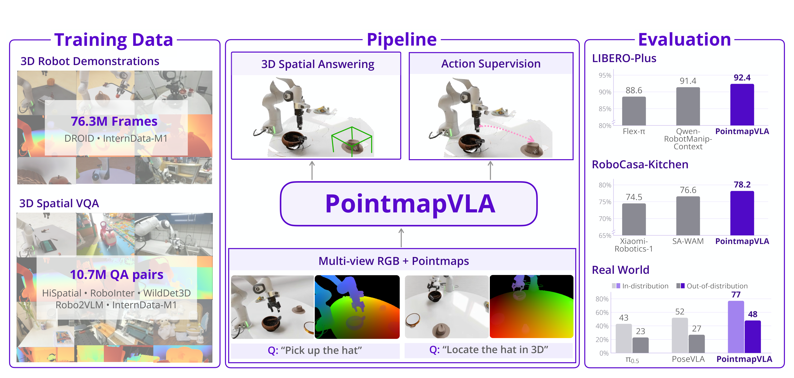

<div align="center">

<h1>PointmapVLA:<br>Scaling Robot Learning with Robot-Centric Pointmaps</h1>

[](https://godnpeter.github.io/PointmapVLA-projectpage/static/PointmapVLA.pdf)
[](#)
[](https://godnpeter.github.io/PointmapVLA-projectpage/)
[](https://github.com/DAVIAN-Robotics/PointmapVLA)
[](https://huggingface.co/collections/DAVIAN-Robotics/pointmapvla-6ad5c4aca150e48c97576ffd)
[](LICENSE)

[Dongyoon&nbsp;Hwang](https://godnpeter.github.io)<sup>\*1</sup>, &nbsp;
[Dongjin&nbsp;Kim](https://k00dj-19.github.io/)<sup>\*1</sup>, &nbsp;
[Byungkun&nbsp;Lee](https://lee15253.github.io/)<sup>\*1</sup>, &nbsp;
[Kyungmin&nbsp;Lee](https://kyungminn.github.io/)<sup>1</sup>,<br>
[Dohyun&nbsp;Lee](https://aiclaudev.github.io/)<sup>1</sup>, &nbsp;
[Hojoon&nbsp;Lee](https://joonleesky.github.io/)<sup>2</sup>, &nbsp;
[Minho&nbsp;Park](https://pmh9960.github.io)<sup>1</sup>, &nbsp;
[Jaegul&nbsp;Choo](https://sites.google.com/site/jaegulchoo/)<sup>†1</sup>

<sup>1</sup>KAIST AI &nbsp;&nbsp;&nbsp; <sup>2</sup>Holiday Robotics<br>
<sup>\*</sup>Equal contribution &nbsp;&nbsp;&nbsp; <sup>†</sup>Corresponding author

**🚀 Released (2026.10)** — code, checkpoints and fine-tuning data

</div>

---

> **TL;DR** — PointmapVLA is a vision-language-action model that sees every camera image together with a pixel-aligned **robot-base-frame pointmap**, the metric 3D position of each pixel relative to the robot. Unlike RGB-only VLAs, which must infer the scene's geometry while learning to act, PointmapVLA receives that geometry explicitly and learns to read it through pointmap-conditioned 3D spatial VQA trained jointly with actions, reaching **92.4% on LIBERO-Plus** and **78.2% on RoboCasa**.

<div align="center">

<br><em>PointmapVLA jointly learns robot control and 3D spatial understanding from multi-view RGB and robot-base-frame pointmaps.</em>
</div>

**This repository** provides the code to **fine-tune and evaluate PointmapVLA on the
simulation benchmarks of the paper** (LIBERO, LIBERO-Plus, RoboCasa): loading the released checkpoints,
fine-tuning from the pretrained model with the exact recipes, and reproducing the reported
numbers. (Pretraining code and data and the real-robot setup are part of the full system
described in the paper and are not included here.)


## Highlights

- **Input**: multi-view RGB images (three cameras on RoboCasa, agent-view + wrist on LIBERO),
  one pixel-aligned pointmap per view, a language instruction, and the robot state.
  Pointmaps are built on the fly from metric depth and camera intrinsics/extrinsics, with
  the same code in training and in the simulator clients.
- **Output**: a chunk of continuous end-effector actions (16 steps on RoboCasa, 8 on LIBERO),
  produced by a flow-matching action expert in 4 Euler steps.
- **Backbone**: Qwen3.5-4B with a **pointmap encoder** initialized from its own vision tower.
  RGB and pointmap features share one patch grid and are added into a single token, so each
  token carries what the patch shows and where it is relative to the robot, with as many
  visual tokens as RGB alone. A 32-layer layer-wise DiT action expert reads the backbone's
  hidden states at every layer (6.08 B parameters in total).
- **Training**: two stages on **76.3 M** pointmap-enriched robot frames and **10.7 M**
  pointmap-paired 3D spatial VQA examples. Stage 1 learns to read pointmaps (spatial
  questions and discrete action tokens under one next-token loss); Stage 2 adds the
  continuous action expert while the Stage 1 losses stay on.
- **Reproducible**: pinned environments, one-command installers for the training stack and
  the three simulators, the exact fine-tuning configs of the released checkpoints, and
  evaluation drivers that follow the paper protocol. Re-training from the released
  pretrained weights in a fresh clone recovers the paper numbers
  ([`docs/reproduction.md`](docs/reproduction.md)).


## 🤗 Model Zoo & Dataset

| Model / Dataset | Note |
|---|---|
| [PointmapVLA-Pretrained](https://huggingface.co/DAVIAN-Robotics/PointmapVLA-Pretrained) | Pretrained model; the starting point for fine-tuning. |
| [PointmapVLA-RoboCasa](https://huggingface.co/DAVIAN-Robotics/PointmapVLA-RoboCasa) | Fine-tuned on RoboCasa kitchen-24 (MG-300). |
| [PointmapVLA-LIBERO](https://huggingface.co/DAVIAN-Robotics/PointmapVLA-LIBERO) | Fine-tuned on the four LIBERO suites; also evaluated zero-shot on LIBERO-Plus. |
| [robocasa-MG_300-r6](https://huggingface.co/datasets/DAVIAN-Robotics/robocasa-MG_300-r6) | RoboCasa MG-300 fine-tuning data: RGB, state and action. |
| [robocasa-MG_300-pointmap](https://huggingface.co/datasets/DAVIAN-Robotics/robocasa-MG_300-pointmap) | Depth and camera parameters for the same episodes, from which pointmaps are built. |
| [libero-r6](https://huggingface.co/datasets/DAVIAN-Robotics/libero-r6) | LIBERO fine-tuning data: RGB, state and action. |
| [libero-r6-pointmap](https://huggingface.co/datasets/DAVIAN-Robotics/libero-r6-pointmap) | Depth and camera parameters for the same episodes. |

All of them are in the [PointmapVLA collection](https://huggingface.co/collections/DAVIAN-Robotics/pointmapvla-6ad5c4aca150e48c97576ffd).


## Release TODO

- [x] Checkpoints, fine-tuning and evaluation code for LIBERO, LIBERO-Plus and RoboCasa
- [x] Fine-tuning datasets
- [ ] Pretraining code and data


## Performance

Success rates (%) of PointmapVLA fine-tuned on each benchmark's training set, compared
with the baselines reported in the paper (Tables 1 and 2). Per-benchmark checkpoints and
the commands that reproduce each number are listed under
[Reproducing Benchmark Results](#reproducing-benchmark-results); what we obtained when we
re-ran the released artifacts ourselves is recorded in
[`docs/reproduction.md`](docs/reproduction.md).

### LIBERO and LIBERO-Plus

LIBERO: four suites (Spatial, Object, Goal, Long), 10 tasks x 50 episodes each.
LIBERO-Plus: 10,030 perturbed episodes (camera, robot state, language, lighting, background,
sensor noise, object layout), evaluated **zero-shot with the LIBERO checkpoint**.

| Method | Type | LIBERO (Avg.) | LIBERO-Plus |
|---|---|---|---|
| Cosmos-Policy | WAM | 98.5 | 82.2 |
| ABot-M0.5 | WAM | 99.4 | 83.4 |
| InternVLA-A1.5 | VLA | 98.9 | 84.8 |
| Qwen-RobotManip | VLA | 99.1 | 89.0 |
| Qwen-RobotManip-Context | VLA | 99.2 | 91.4 |
| GAM | Geometry-aware WAM | 97.6 | 85.5 |
| GIFT-WAM-IDM | Geometry-aware WAM | 98.5 | 87.8 |
| Flex-π | Geometry-aware WAM | 98.5 | 88.6 |
| Spatial Forcing | Geometry-aware VLA | 98.5 | 29.1 |
| ABot-M0 | Geometry-aware VLA | 98.6 | 80.5 |
| **PointmapVLA (ours)** | Geometry-aware VLA | **99.0** | **92.4** |

PointmapVLA per suite: Spatial 99.4, Object 99.5, Goal 99.3, Long 97.9. Per perturbation
axis on LIBERO-Plus: Camera 88.0, Robot 83.7, Language 92.6, Light 99.0, Background 98.8,
Noise 99.3, Layout 88.9. The full comparison with per-suite and per-axis baseline numbers is
in the paper's appendix (Tables 9 and 10).

### RoboCasa

24 atomic kitchen tasks, 50 episodes each, fine-tuned on 300 MimicGen demonstrations per
task (MG-300).

| Method | Type | RoboCasa kitchen-24 |
|---|---|---|
| UWM | WAM | 60.8 |
| DreamZero | WAM | 62.4 |
| Cosmos Policy | WAM | 67.1 |
| RLDX-1 | VLA | 70.6 |
| Xiaomi-Robotics-1 | VLA | 74.5 |
| GAM | Geometry-aware WAM | 69.4 |
| DeVA | Geometry-aware WAM | 72.0 |
| SA-WAM | Geometry-aware WAM | 76.6 |
| GeoPredict | Geometry-aware VLA | 52.4 |
| SeeR-VLA | Geometry-aware VLA | 61.5 |
| **PointmapVLA (ours)** | Geometry-aware VLA | **78.2** |

Per-task success rates of PointmapVLA and additional baselines are in the paper's appendix
(Tables 11 and 12).


## Installation

**Requirements**: Linux, conda, an NVIDIA driver for CUDA 12.8, `gcc` on the path (the
backbone's linear-attention kernels are JIT-compiled by Triton), 4 GPUs for fine-tuning.

Three conda environments are used: one for training and serving the model, and one per
simulator family (the simulators pin numpy/robosuite versions that conflict with the
training stack; server and simulator client talk over a websocket).

```bash
git clone https://github.com/DAVIAN-Robotics/PointmapVLA.git
cd PointmapVLA

scripts/install_train_env.sh             # env "pointmapvla": pinned torch 2.7.1 / transformers 5.3.0 / DeepSpeed stack
scripts/install_sim_robocasa.sh          # env "robocasa_kitchen"; downloads ~5 GB of kitchen assets
scripts/install_sim_libero.sh            # env "libero"
scripts/install_sim_libero.sh --plus     # env "libero_plus"; downloads the 6.4 GB LIBERO-Plus asset pack
```

Verify the training environment:

```bash
conda activate pointmapvla
python -c "from starVLA.model.framework.VLM4A.PointmapVLA import PointmapVLA; print('ok')"
pytest tests/eval
```

The installers use prebuilt wheels for the compiled kernels, so no CUDA toolkit is needed
to install. At run time, `CUDA_HOME` must point at a CUDA toolkit when DeepSpeed is
imported; `scripts/train.sh` sets it to `/usr/local/cuda-12.8` or `/usr/local/cuda` when
one exists. Simulators are cloned at pinned commits under `third_party/` (tag
`pointmapvla-v1`). Details and troubleshooting: [`docs/training.md`](docs/training.md),
[`docs/evaluation.md`](docs/evaluation.md).


## Documentation

| Guide | What it covers |
|---|---|
| [`docs/training.md`](docs/training.md) | Fine-tuning recipes, the 4-GPU minimum and why, 80 GB variants, resume, head remap, numerical guard |
| [`docs/evaluation.md`](docs/evaluation.md) | LIBERO / LIBERO-Plus evaluation: server + client split, seeds, sharding, aggregation, Slurm |
| [`examples/simBenchmarks/Robocasa_kitchen/README.md`](examples/simBenchmarks/Robocasa_kitchen/README.md) | RoboCasa kitchen-24 evaluation and the live pointmap construction from simulator depth |
| [`docs/reproduction.md`](docs/reproduction.md) | Evaluation protocol, what we measured when re-running the release, same-recipe variance |
| [`tests/parity/README.md`](tests/parity/README.md) | Parity tests against the original training code (bitwise data layer, exact model outputs) |
| [`UPSTREAM.md`](UPSTREAM.md) | Relationship to starVLA: base commit, byte-identical files, what PointmapVLA adds |


## Checkpoints

All three checkpoints are 6.08 B parameters in bf16 (about 11 GB). Their action/state heads
differ: 32-D / 17-D for the pretrained model (fine-tune it before use), 15-D / 18-D for
RoboCasa and 10-D / 11-D for LIBERO. They share one layout, which is also the layout of a
training run directory:

```
PointmapVLA-<name>/
├── README.md                          model card
├── config.yaml                        architecture + the data recipe it was trained with
├── dataset_statistics.json            action/state statistics used for (un)normalisation
├── base_vlm/                          Qwen3.5-4B config, tokenizer and processor (no weights)
└── checkpoints/
    ├── model-0000{1,2,3}-of-00003.safetensors
    └── model.safetensors.index.json
```

`PointmapVLA.from_pretrained` accepts a Hugging Face repo id, a local run directory, or a
weight file inside a run directory's `checkpoints/`; the same three forms work for
`trainer.pretrained_checkpoint` in the training configs and for `--ckpt` of the policy
server.

```python
from starVLA.model.framework.VLM4A.PointmapVLA import PointmapVLA

model = PointmapVLA.from_pretrained("DAVIAN-Robotics/PointmapVLA-RoboCasa")
actions = model.predict_action(examples)       # see deployment/model_server/ for the input format
```


## Data

The processed fine-tuning data are LeRobot v3.0 datasets. Each benchmark needs two: one
with RGB videos, states and actions, and one with the frame-aligned depth videos and
camera parameters from which the loader builds pointmaps on the fly.

RoboCasa needs about 131 GB (11 GB RGB + 120 GB depth) and LIBERO about 8 GB. Both are
downloaded into the paths the shipped configs expect:

```bash
conda activate pointmapvla
python scripts/download_data.py --bench robocasa libero        # -> playground/Datasets/..., where the configs expect them
python scripts/verify_data.py playground/Datasets/libero_r6 --sha256   # optional: check against the shipped MANIFEST.json
```

**Pointmap format.** Pointmaps are never stored. Depth is FFV1 `gray16le` video with
`uint16 = depth[m] x 10000` (`0` = invalid; points with `0.05 m < z < 6.5 m` are kept),
intrinsics are `fx, fy, cx, cy` for the 256 x 256 render (negative `fx` in LIBERO encodes
its 180° image rotation), extrinsics are per-frame camera-to-world poses as position +
quaternion `w, x, y, z` in OpenCV axes, and the robot base pose expresses everything in the
base frame. End-effector rotations are stored as **r6** (first two rows of the rotation
matrix) in both state and action; the server converts predicted r6 back to axis-angle for
the simulator. `starVLA/dataloader/gr00t_lerobot/transform/pointmap_math.py` is the single
implementation used by training and by both simulator clients. Full feature tables are in
the dataset cards.


## Fine-tuning

The shipped configs are the exact recipes of the released checkpoints, starting from
`DAVIAN-Robotics/PointmapVLA-Pretrained`:

| Config | Steps | GPUs x batch x accum |
|---|---|---|
| `examples/simBenchmarks/Robocasa_kitchen/train_files/pointmapvla_robocasa_kitchen.yaml` | 20,000 | 4 x 32 x 1 |
| `examples/simBenchmarks/Robocasa_kitchen/train_files/pointmapvla_robocasa_kitchen_80gb.yaml` | 20,000 | 4 x 8 x 4 |
| `examples/simBenchmarks/LIBERO/train_files/pointmapvla_libero.yaml` | 30,000 | 4 x 32 x 1 |
| `examples/simBenchmarks/LIBERO/train_files/pointmapvla_libero_80gb.yaml` | 30,000 | 4 x 8 x 4 |

```bash
conda activate pointmapvla
scripts/train.sh examples/simBenchmarks/Robocasa_kitchen/train_files/pointmapvla_robocasa_kitchen.yaml
scripts/train.sh examples/simBenchmarks/LIBERO/train_files/pointmapvla_libero.yaml

# 80 GB GPUs (A100/H100): same global batch 128 via gradient accumulation
scripts/train.sh examples/simBenchmarks/LIBERO/train_files/pointmapvla_libero_80gb.yaml

# any extra argument is an OmegaConf dotlist override, e.g. a smoke test
scripts/train.sh examples/simBenchmarks/LIBERO/train_files/pointmapvla_libero_80gb.yaml --trainer.max_train_steps 50
```

**Four GPUs is the minimum.** Training uses DeepSpeed ZeRO-2, which keeps a flat fp32
partition of the 6.08 B parameters per rank; in the pinned versions a partition above 2^31
elements silently corrupts the weights, which happens with 1 or 2 ranks. Eight GPUs work
with `NGPU=8 scripts/train.sh <config> --datasets.vla_data.per_device_batch_size 16`. The
plain configs need about 150 GB per GPU; the `_80gb` variants fit 80 GB cards. On 4 B200
GPUs the recipes take about 7 h 15 min (RoboCasa) and 9 h (LIBERO). Resubmitting the same
run resumes from its newest checkpoint. A Slurm example is in `slurm/train.sbatch`; details
in [`docs/training.md`](docs/training.md).

Fine-tuning on your own data means adding a data config (see the registries under
`examples/simBenchmarks/*/train_files/data_registry/`) that names the RGB and depth
datasets, the camera keys and the state/action layout; the loader builds the pointmaps.


## Evaluation

Evaluation runs a websocket policy server (training env, one per GPU) and a simulator
client (simulator env), then the aggregator. The one-node drivers do all of this, follow
the paper protocol by default, and skip results that already exist, so re-running resumes:

```bash
# RoboCasa kitchen-24: 24 tasks x 50 episodes x 3 repetitions (policy seeds 0, 1, 2)
CKPT=DAVIAN-Robotics/PointmapVLA-RoboCasa GPUS=0,1 scripts/eval/run_eval_robocasa.sh

# LIBERO (4 suites) and LIBERO-Plus (10,030 episodes): one run per seed; the paper uses 7, 8, 9
for s in 7 8 9; do CKPT=DAVIAN-Robotics/PointmapVLA-LIBERO BENCH=libero      SEED=$s GPUS=0   scripts/eval/run_eval_libero.sh; done
for s in 7 8 9; do CKPT=DAVIAN-Robotics/PointmapVLA-LIBERO BENCH=libero_plus SEED=$s GPUS=0,1 scripts/eval/run_eval_libero.sh; done

# mean ± s.d. over the three seeds
python examples/simBenchmarks/aggregate_eval_results.py libero      results/libero/s7      results/libero/s8      results/libero/s9
python examples/simBenchmarks/aggregate_eval_results.py libero_plus results/libero_plus/s7 results/libero_plus/s8 results/libero_plus/s9
```

`CKPT` accepts a repo id, a run directory or a weight file, so a fine-tune of your own is
evaluated the same way. Slurm versions of the drivers are next to the clients
(`eval_kitchen24.sbatch`, `eval_libero_vec.sbatch`). Every reported number is a mean over
three evaluations; one run scatters by about ±1.3 points on RoboCasa and ±0.2 on LIBERO,
see [`docs/reproduction.md`](docs/reproduction.md).


## Reproducing Benchmark Results

| Benchmark | Fine-tuned checkpoint | Train config | Eval guide |
|---|---|---|---|
| LIBERO | [PointmapVLA-LIBERO](https://huggingface.co/DAVIAN-Robotics/PointmapVLA-LIBERO) | `LIBERO/train_files/pointmapvla_libero.yaml` | [`docs/evaluation.md`](docs/evaluation.md) |
| LIBERO-Plus | [PointmapVLA-LIBERO](https://huggingface.co/DAVIAN-Robotics/PointmapVLA-LIBERO) (zero-shot) | same | [`docs/evaluation.md`](docs/evaluation.md) |
| RoboCasa kitchen-24 | [PointmapVLA-RoboCasa](https://huggingface.co/DAVIAN-Robotics/PointmapVLA-RoboCasa) | `Robocasa_kitchen/train_files/pointmapvla_robocasa_kitchen.yaml` | [`Robocasa_kitchen/README.md`](examples/simBenchmarks/Robocasa_kitchen/README.md) |

Train configs live under `examples/simBenchmarks/`. The parity tests in `tests/parity/`
check that this code reproduces the original training code's data pipeline bitwise and its
model outputs exactly (see [`tests/parity/README.md`](tests/parity/README.md)).


## Project Structure

PointmapVLA is built on [starVLA](https://github.com/starVLA/starVLA) and keeps its package
name, layout and registries so it can be contributed back as one more framework
([`UPSTREAM.md`](UPSTREAM.md)). The PointmapVLA-specific files:

```
starVLA/
├── model/
│   ├── framework/VLM4A/PointmapVLA.py            the framework: model, loading, head remap, predict_action
│   ├── framework/checkpoint_io.py                run dir | weight file | HF repo id resolution
│   └── modules/
│       ├── vlm/QWen3_5_pointmap.py               pointmap-aware Qwen3.5 interface
│       ├── vlm/qwen3_5/modeling_qwen3_5_pointmap.py   vision tower with the pointmap add
│       └── action_model/PointmapVLA_ActionHeader.py   layer-wise flow-matching DiT expert
├── dataloader/
│   ├── qwenvl_collator.py, prompt_norm.py         prompt template and batch collation
│   └── gr00t_lerobot/
│       ├── paired_pointmap_dataset.py             joins RGB and depth datasets by episode
│       └── transform/pointmap*.py                 depth -> base-frame pointmap
├── training/train_starvla.py                      trainer (DeepSpeed ZeRO-2, resume, NaN guard)
└── config/deepseeds/, config/fla_configs/         DeepSpeed configs, kernel autotune tables
deployment/model_server/                           websocket policy server
examples/simBenchmarks/
├── Robocasa_kitchen/                              data registry, train configs, eval client
├── LIBERO/                                        data registry, train configs, vectorised eval client
└── aggregate_eval_results.py                      aggregator with integrity checks
scripts/                                           installers, data download/verify, train and eval drivers
slurm/                                             Slurm training example
tests/                                             parity and aggregator tests
```


## Citation

TBD. The paper is under double-blind review; the BibTeX entry and author list will be
added at camera-ready.


## Acknowledgments

PointmapVLA builds upon the following open-source projects:

- [starVLA](https://github.com/starVLA/starVLA) — training codebase
- [Qwen3.5](https://huggingface.co/Qwen) — vision-language backbone
- [NVIDIA Isaac GR00T](https://github.com/NVIDIA/Isaac-GR00T) — LeRobot data loader the data layer derives from
- [RoboCasa](https://github.com/robocasa/robocasa), the [RLDX-1](https://github.com/RLWRLD/RLDX-1) kitchen fork and MG-300 demonstrations
- [LIBERO](https://github.com/Lifelong-Robot-Learning/LIBERO) and [LIBERO-plus](https://github.com/sylvestf/LIBERO-plus)


## License

- **Code**: [MIT](LICENSE). Third-party components and their licenses are listed in
  [NOTICE](NOTICE).
- **Model weights**: MIT, derived from Qwen3.5-4B (Apache License 2.0).
- **Datasets**: see the license section of each dataset card; the RoboCasa and LIBERO
  derivatives keep their upstream terms.


## Contributions

If you hit a bug or a broken reproduction step, please open an issue at
[github.com/DAVIAN-Robotics/PointmapVLA/issues](https://github.com/DAVIAN-Robotics/PointmapVLA/issues).
